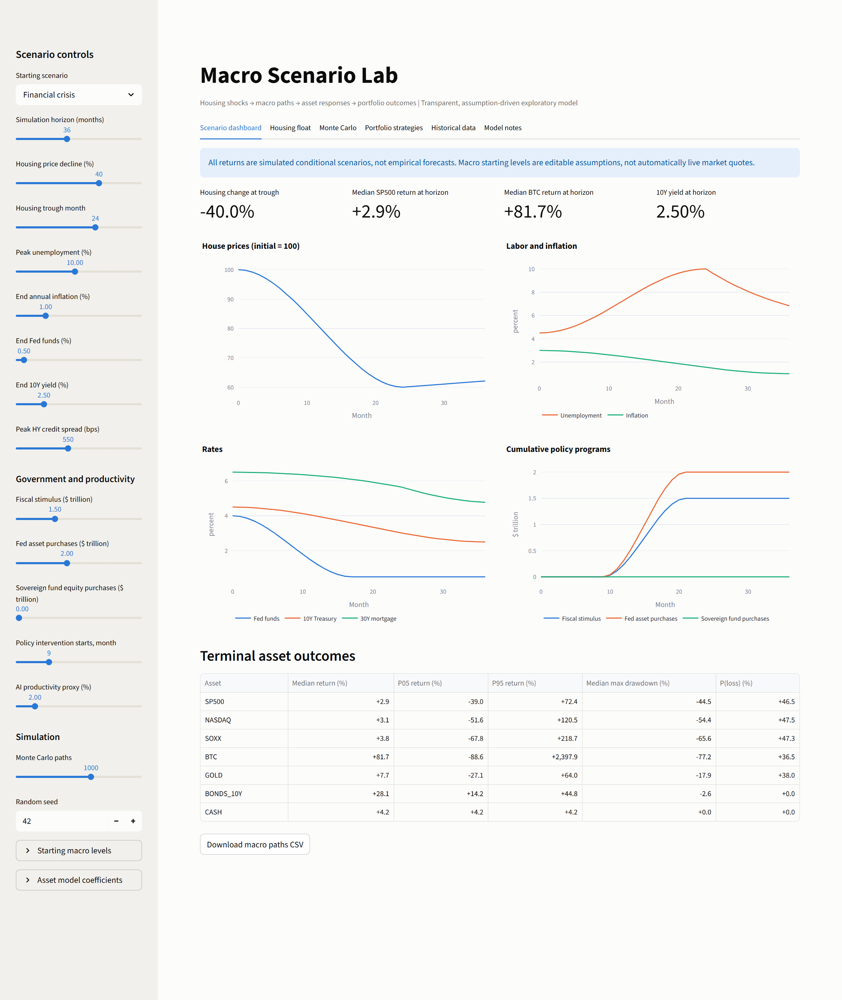
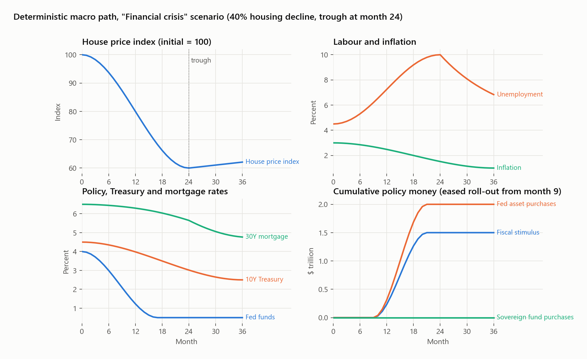
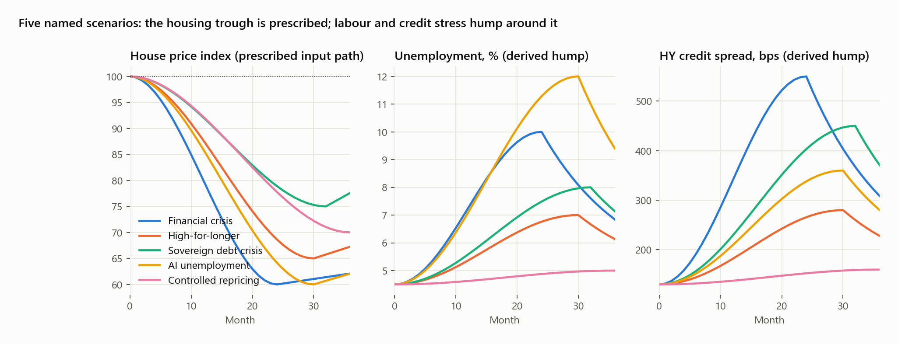
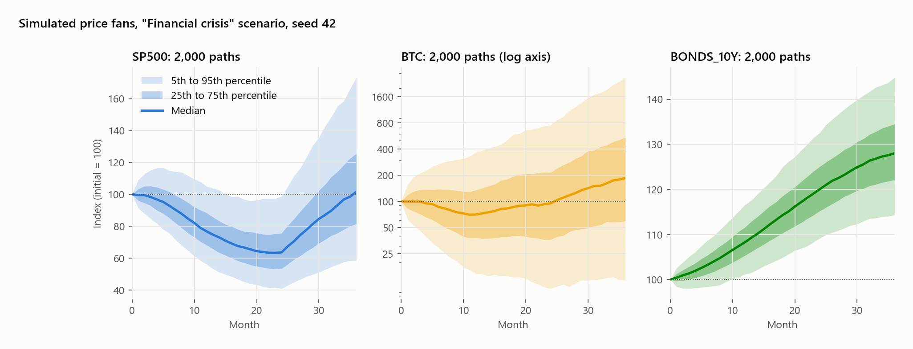
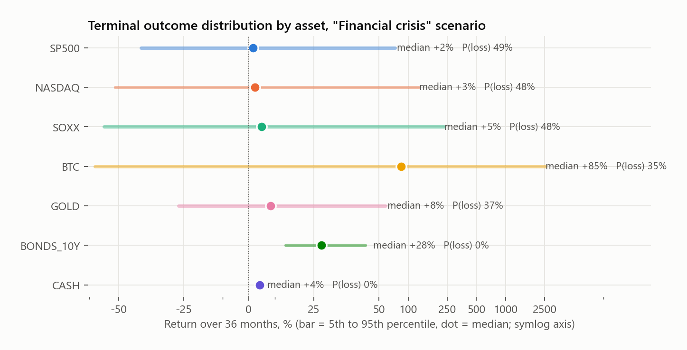
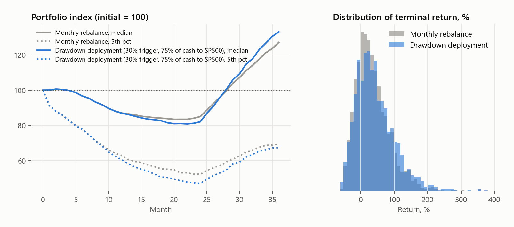
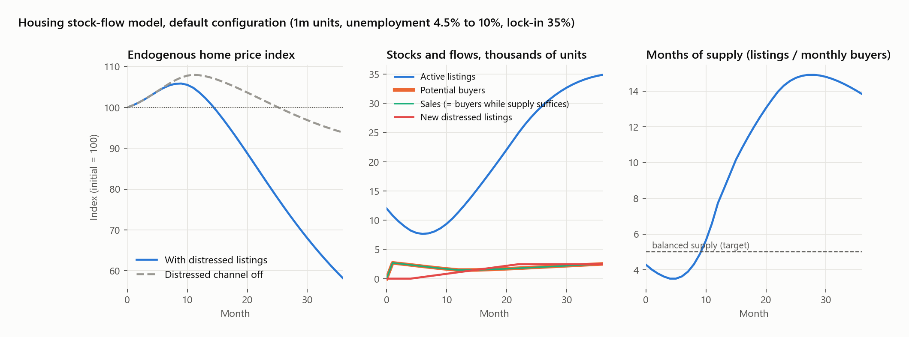
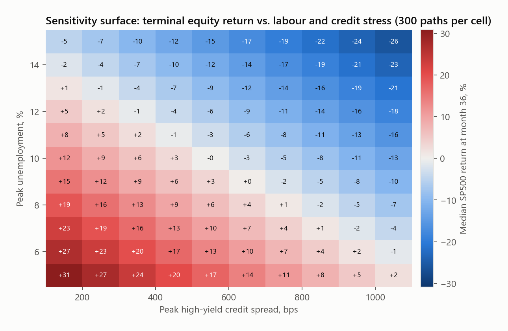
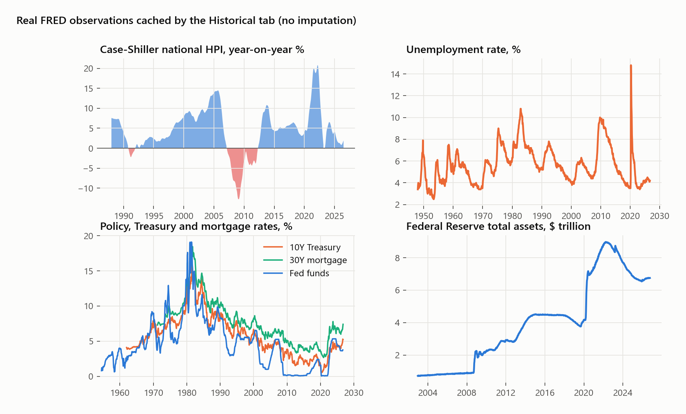

# Macro Scenario Lab

**A transparent, assumption-driven simulator of housing shocks, the macro paths they imply, and the joint asset-return and portfolio outcomes conditional on those paths. Includes an independent housing stock-flow model, a Monte Carlo engine with a shared risk factor, strategy backtests with no look-ahead, and a cache of real FRED history.**

<p align="center">
  
</p>

The question the tool is built around is narrow and practical: *if* US house prices fell by some amount over some horizon, and labour, credit, rates and policy responded in a stylised but explicit way, what would the distribution of outcomes look like for a multi-asset portfolio, and how would a rule-based deployment of cash compare with passive rebalancing? The model does **not** forecast the housing decline. It takes the decline as the conditioning input, derives the rest of the macro state from a small set of smooth functional forms whose parameters are all exposed in the interface, and then simulates correlated asset paths. Every number it produces is conditional on assumptions the user can see and change.

## Contents

- [What is in the repository](#what-is-in-the-repository)
- [Quick start](#quick-start)
- [Model specification](#model-specification)
  - [1. Scenario to macro path](#1-scenario-to-macro-path)
  - [2. Macro path to asset returns](#2-macro-path-to-asset-returns)
  - [3. Portfolio and deployment rule](#3-portfolio-and-deployment-rule)
  - [4. Housing stock-flow model](#4-housing-stock-flow-model)
- [Results under the default scenarios](#results-under-the-default-scenarios)
- [Historical data](#historical-data)
- [Reproducibility and tests](#reproducibility-and-tests)
- [Scope and honesty notes](#scope-and-honesty-notes)
- [Roadmap](#roadmap)
- [Citation](#citation)
- [License](#license)

## What is in the repository

| Path | Role |
| --- | --- |
| [`models/engine.py`](models/engine.py) | The scenario engine: `Scenario`, `Baseline`, `Sensitivities` dataclasses; `macro_path()` (deterministic macro state), `simulate()` (Monte Carlo price tensor), `summarize()`, `portfolio()`. About 150 lines, numpy and pandas only. |
| [`models/housing_float.py`](models/housing_float.py) | A monthly housing stock-flow simulator: listings, buyers, sales, withdrawals, months of supply and an endogenous price index. Independent of the engine. |
| [`data/historical.py`](data/historical.py) | Downloads ten FRED series as published CSVs into `data/cache/` and aligns them to month-start. No API key, no imputation. |
| [`app.py`](app.py) | The Streamlit dashboard: six tabs over the three modules above. |
| [`theme.py`](theme.py) | One colour system shared by the dashboard (Plotly) and the figures (Matplotlib). Categorical hues are assigned to entities in a fixed, colour-vision-safe order. |
| [`scripts/make_figures.py`](scripts/make_figures.py) | Regenerates every figure in this README from the engine with the default seed. |
| [`scripts/screenshot.py`](scripts/screenshot.py) | Captures the dashboard tabs with Playwright. |
| [`tests/`](tests/) | Nine invariant and directional tests (`pytest`). |

## Quick start

Python 3.10 or newer.

```bash
pip install -r requirements.txt
streamlit run app.py
```

The dashboard opens with the *Financial crisis* scenario. The sidebar sets the scenario (housing decline, trough month, unemployment peak, inflation, policy and Treasury endpoints, credit spread peak, fiscal and monetary programme sizes, intervention timing), the Monte Carlo configuration (path count, seed), and under two expanders the starting macro levels and every asset sensitivity coefficient. Nothing is hidden in the code that is not also reachable from the interface.

To regenerate the figures and screenshots used below:

```bash
pip install -r requirements-dev.txt
python -m playwright install chromium
python scripts/make_figures.py                     # docs/figures/*.png
streamlit run app.py --server.port 8765 --server.headless true &
python scripts/screenshot.py                       # docs/screenshots/*.png
```

## Model specification

All time indices are months, $t = 0, 1, \dots, T$. Let $s(x) = 3x^2 - 2x^3$ on $[0,1]$ (clipped outside) denote the smoothstep easing function used for every monotone transition. It has zero slope at both ends, so paths start and finish without kinks.

### 1. Scenario to macro path

A `Scenario` is a vector of endpoints and timings: housing decline $d$, trough month $T_b$, unemployment peak $u^\star$, terminal inflation $\pi_T$, terminal policy rate $f_T$, terminal 10-year yield $y_T$, peak high-yield spread $c^\star$, cumulative fiscal stimulus $\bar S$, central-bank asset purchases $\bar Q$, sovereign-fund equity purchases $\bar W$, an AI-productivity proxy $A$, and the month $T_p$ at which policy begins. A `Baseline` gives the starting levels $u_0, \pi_0, f_0, y_0, m_0, c_0$.

**House prices** are the prescribed input. The index eases down to the trough and then recovers by a fixed 3.5 % over the remainder of the horizon:

$$
H_t = 100\,\bigl(1 - d\, s(t/T_b)\bigr)\Bigl(1 + 0.035\, \mathrm{clip}\!\bigl(\tfrac{t - T_b}{T - T_b},0,1\bigr)\Bigr).
$$

**Labour and credit stress** share a single hump that rises as $\sin^2$ to the trough and decays exponentially afterwards with a 14-month time constant:

$$
g_t = \sin^2\!\Bigl(\frac{\pi}{2}\min(t/T_b, 1)\Bigr)\cdot
\begin{cases}1 & t \le T_b\\ e^{-(t-T_b)/14} & t > T_b\end{cases},
\qquad
u_t = u_0 + (u^\star - u_0)\, g_t,\quad
c_t = c_0 + (c^\star - c_0)\, g_t .
$$

**Inflation and the long yield** ease linearly in $s$ over the full horizon; the **policy rate** eases over a window tied to the policy start:

$$
\pi_t = \pi_0 + (\pi_T - \pi_0)\, s(t/T),\qquad
y_t = y_0 + (y_T - y_0)\, s(t/T),\qquad
f_t = f_0 + (f_T - f_0)\, s\!\bigl(t / \max(6, T_p + 8)\bigr).
$$

**The mortgage rate** is the long yield plus the starting mortgage-Treasury spread plus a credit-sensitive premium, and **policy money** is rolled out with the same easing over twelve months from $T_p$:

$$
m_t = \max\bigl(0,\; y_t + (m_0 - y_0) + 0.0015\,(c_t - c_0)\bigr),\qquad
S_t = \bar S\, s\!\Bigl(\frac{t - T_p}{12}\Bigr),\; Q_t = \bar Q\, s(\cdot),\; W_t = \bar W\, s(\cdot).
$$

The real yield is $r_t = y_t - \pi_t$. The function `macro_path()` returns this entire state as a DataFrame; it is deterministic.

<p align="center">
  
</p>

Five named scenarios ship as defaults. Their housing paths are inputs; their unemployment and credit humps follow from the equations above.

<p align="center">
  
</p>

### 2. Macro path to asset returns

Seven assets are simulated: `SP500`, `NASDAQ`, `SOXX`, `BTC`, `GOLD`, `BONDS_10Y`, `CASH`. For each month the engine forms an expected monthly log return from the *changes* in the macro state, then adds a correlated shock. Writing $\Delta x_t = x_t - x_{t-1}$ and $\Delta L_t = \Delta S_t + \Delta Q_t + \Delta W_t$ for the liquidity impulse:

$$
\begin{aligned}
\mu^{E}_t &= 0.004 - \beta_c \tfrac{\Delta c_t}{100} - \beta_u \Delta u_t - \beta_y \Delta y_t + \beta_s \Delta S_t + \beta_q \Delta Q_t + \beta_w \Delta W_t, \\
\mu^{NDQ}_t &= 1.25\,\mu^{E}_t + 0.002\,A/12, \qquad
\mu^{SOXX}_t = 1.6\,\mu^{E}_t + 0.004\,A/12, \\
\mu^{BTC}_t &= 0.007 + \beta_L \Delta L_t - \beta^{B}_c \tfrac{\Delta c_t}{100} - \beta^{B}_r \Delta r_t - 0.085\,\Delta u_t, \\
\mu^{GOLD}_t &= 0.003 + \gamma_\pi \Delta\pi_t - \gamma_r \Delta r_t + 0.015\,\Delta Q_t + 0.008\,\tfrac{\Delta c_t}{100}, \\
\mu^{BOND}_t &= \frac{y_{t-1}}{1200} - D\,\frac{\Delta y_t}{100}, \qquad
\mu^{CASH}_t = \frac{\max(f_{t-1},0)}{1200}.
\end{aligned}
$$

The default sensitivities are $\beta_c = 0.065$, $\beta_u = 0.075$, $\beta_y = 0.045$, $\beta_s = 0.016$, $\beta_q = 0.022$, $\beta_w = 0.055$, $\beta_L = 0.22$, $\beta^B_c = 0.14$, $\beta^B_r = 0.10$, $\gamma_\pi = 0.035$, $\gamma_r = 0.060$, duration $D = 7$. Every one of them is a slider.

**Shock structure.** Monthly innovations load on one common factor $z_t \sim N(0,1)$ plus an idiosyncratic term $\eta_{i,t} \sim N(0,1)$:

$$
\varepsilon_{i,t} = \sigma_i \Bigl(\beta_i z_t + \sqrt{\max(0,\,1 - \beta_i^2/3)}\;\eta_{i,t}\Bigr),
\qquad
P_{i,t} = P_{i,t-1}\exp\bigl(\mu_{i,t} + \varepsilon_{i,t}\bigr).
$$

with monthly volatilities $\sigma = (0.045, 0.060, 0.082, 0.17, 0.04, 0.012, 0)$ and factor loadings $\beta = (0.8, 1.05, 1.30, 1.55, -0.12, -0.20, 0)$ in asset order. Risk assets therefore crash together, gold and bonds lean the other way, and cash is riskless. A global multiplier scales all $\sigma_i$. Note that the idiosyncratic weight is $\sqrt{1 - \beta_i^2/3}$ rather than $\sqrt{1 - \beta_i^2}$, so total variance is $\sigma_i^2(1 + 2\beta_i^2/3)$, not $\sigma_i^2$; this is deliberate so that high-beta assets are both more correlated *and* more volatile, but it means $\sigma_i$ should be read as a scale, not the marginal standard deviation. The bond log return is floored at $-0.95$ as a numerical guard.

<p align="center">
  
</p>

`summarize()` reports, per asset, the median and 5th/95th percentile terminal return, the median maximum drawdown along the path, and the share of paths that finish below the start.

<p align="center">
  
</p>

### 3. Portfolio and deployment rule

`portfolio()` takes the price tensor and a weight vector $w$ (non-negative, summing to one; no leverage). The passive benchmark rebalances to $w$ every month. The active rule holds the same weights until the first month in which the target asset's drawdown from its running peak reaches a trigger $\tau$:

$$
\frac{P_{j,t}}{\max_{s \le t} P_{j,s}} - 1 \le -\tau
\quad\Longrightarrow\quad
w_{\text{cash}} \leftarrow (1-\phi)\, w_{\text{cash}},\;\;
w_j \leftarrow w_j + \phi\, w_{\text{cash}},
$$

executed once per path. The observation is made at month-end $t$ and the new weights earn the return from $t$ to $t+1$, so there is no look-ahead. Execution costs, spreads and taxes are omitted.

<p align="center">
  
</p>

### 4. Housing stock-flow model

The *Housing float* tab is a separate, self-contained model of listing inventory and price discovery; it does **not** feed the asset engine (see [scope notes](#scope-and-honesty-notes)). Counts are in housing units out of a stock $S$; vacancy is tracked but is *not* assumed to be for sale, which is the distinction the model exists to make.

Unemployment $u_t$ and the mortgage rate $m_t$ ramp linearly to their peaks. Each month after $t = 0$:

$$
\begin{aligned}
\text{distressed listings } D_t &= S\,\delta\,\max\bigl(0,\; u_{t-\ell} - u_0\bigr) &&\text{(lagged $\ell$ months)}\\
\text{voluntary listings } V_t &= S\, v\,(1 - \lambda) &&\text{($\lambda$ = mortgage lock-in)}\\
\text{potential buyers } B_t &= B_0 \max\Bigl(0.02,\; 1 + \kappa\min(\tfrac{t}{R},1) - \rho\,(m_t - m_0) - \eta\ln\tfrac{P_{t-1}}{100}\Bigr) \\
\text{sales } X_t &= \min\bigl(I_{t-1} + V_t + D_t,\; \theta B_t\bigr) \\
\text{inventory } I_t &= (1 - \omega)\bigl(I_{t-1} + V_t + D_t - X_t\bigr) \\
\text{months of supply } M_t &= I_t / B_t \\
\ln P_t - \ln P_{t-1} &= \mathrm{clip}\Bigl(-\psi \ln \tfrac{M_t}{M^\star},\; -0.15,\; 0.15\Bigr).
\end{aligned}
$$

Buyer demand has three channels: a time-ramped exogenous shock $\kappa$ (ramp $R$ months), a mortgage-rate sensitivity $\rho$, and a price elasticity $\eta$ that brings buyers back as prices fall. Prices move toward the user-chosen balanced months of supply $M^\star$ at a speed $\psi$. The per-step change is bounded so extreme slider settings cannot blow up numerically.

<p align="center">
  
</p>

Under the default configuration (1 million units, unemployment 4.5 % to 10 % over 18 months, 35 % lock-in, buyer shock −35 %), the price index first rises to 105.9 at month 9 because lock-in starves the market of voluntary listings, then falls as lagged distressed supply arrives. Switching the distressed channel off changes the 36-month outcome from **−41.9 %** to **−6.2 %**; distressed listings are 43.7 % of new supply over the run. That gap is the model's point: a given level of unemployment does not mechanically imply a crash, the mapping runs through the distressed-listing coefficient $\delta$, which is a judgement.

## Results under the default scenarios

2,000 paths, 36 months, seed 42. Returns are terminal, in percent.

| Scenario | Housing drop | Peak U | Peak HY | Fed end | 10Y end | SP500 median | SP500 P05 | BTC median | Gold median | Bonds median | P(SP500 loss) |
|---|---|---|---|---|---|---|---|---|---|---|---|
| Financial crisis | 40 % | 10 % | 550 bps | 0.50 % | 2.50 % | +1.7 % | −41.4 % | +84.7 % | +8.4 % | +28.0 % | 49 % |
| High-for-longer | 35 % | 7 % | 280 bps | 5.00 % | 6.00 % | −9.1 % | −47.6 % | +13.5 % | +18.2 % | +5.4 % | 62 % |
| Sovereign debt crisis | 25 % | 8 % | 450 bps | 7.00 % | 8.00 % | −21.0 % | −54.5 % | +229.1 % | +70.1 % | −5.6 % | 77 % |
| AI unemployment | 40 % | 12 % | 360 bps | 0.75 % | 2.50 % | −13.8 % | −50.3 % | +31.8 % | +2.4 % | +28.0 % | 68 % |
| Controlled repricing | 30 % | 5 % | 160 bps | 3.00 % | 3.75 % | +14.0 % | −34.3 % | +28.2 % | +6.1 % | +19.4 % | 35 % |

Two things are worth reading off this table. First, the *Financial crisis* scenario is not the worst for equities despite the deepest housing fall, because its rate and liquidity assumptions (policy rate to 0.5 %, $3.5 trillion of combined stimulus and asset purchases) offset the credit and labour shock in the return equations. Second, the Bitcoin medians are an artefact of the liquidity coefficient $\beta_L$ applied to multi-trillion programmes, and the 5th-to-95th range for BTC spans two orders of magnitude; the model is telling you that the assumption dominates, not that it has a view.

Full per-asset table for the *Financial crisis* scenario:

| Asset | Median return (%) | P05 return (%) | P95 return (%) | Median max drawdown (%) | P(loss) (%) |
|---|---|---|---|---|---|
| SP500 | +1.7 | −41.4 | +73.3 | −44.1 | 48.8 |
| NASDAQ | +2.5 | −53.5 | +126.9 | −53.5 | 47.6 |
| SOXX | +5.0 | −70.8 | +232.1 | −64.7 | 47.8 |
| BTC | +84.7 | −87.6 | +2562.5 | −76.6 | 35.3 |
| GOLD | +8.4 | −26.9 | +58.5 | −18.5 | 37.3 |
| BONDS_10Y | +28.0 | +14.3 | +44.8 | −2.5 | 0.1 |
| CASH | +4.2 | +4.2 | +4.2 | 0.0 | 0.0 |

The portfolio comparison with the default weights (25 / 10 / 15 / 10 / 10 / 0 / 30 across the seven assets) and a 30 % trigger deploying 75 % of cash into SP500:

| Strategy | Median final return | 5th percentile | Median max drawdown |
|---|---|---|---|
| Monthly rebalance | +27.1 % | −30.6 % | −32.3 % |
| Drawdown deployment | +33.1 % | −32.7 % | −35.0 % |

The deployment rule raises the median and slightly worsens the tail, which is what buying into a drawdown should do under a mean-reverting scenario; it is not evidence that the rule works out of sample.

**Sensitivity surface.** Because the macro path is deterministic given the scenario, the engine is cheap enough to sweep. Below is the median SP500 terminal return over a grid of unemployment peaks and credit-spread peaks, holding everything else at the *Financial crisis* defaults. The surface is close to additive in the two stressors, as the linear return equations imply.

<p align="center">
  
</p>

## Historical data

The *Historical data* tab downloads ten series from [FRED](https://fred.stlouisfed.org/) as published CSVs into `data/cache/` and plots them. The directory is git-ignored; one click (or `data.historical.fetch_all()`) populates it. Each series keeps its own start date and no observation is imputed.

| Series | Description | First observation |
|---|---|---|
| `CPIAUCSL` | Consumer price index | 1947 |
| `UNRATE` | Unemployment rate | 1948 |
| `FEDFUNDS` | Effective Fed funds rate | 1954 |
| `DGS10` | 10-year Treasury yield | 1962 |
| `MORTGAGE30US` | 30-year mortgage rate | 1971 |
| `USSTHPI` | FHFA all-transactions house price index | 1975 |
| `CSUSHPINSA` | Case-Shiller national home price index | 1987 |
| `WALCL` | Federal Reserve total assets | 2002 |
| `SP500` | S&P 500 (FRED serves a rolling 10-year window) | rolling |
| `BAMLH0A0HYM2` | ICE BofA high-yield option-adjusted spread (FRED serves a rolling recent window) | rolling |

<p align="center">
  
</p>

The historical tab is deliberately *not* wired into the engine. The point of showing the real series next to the simulated ones is to make the contrast visible: the simulated unemployment hump is smooth and symmetric; the real one is not.

## Reproducibility and tests

- `simulate()` is deterministic for a given seed (`numpy.random.default_rng`), and the figures in this README are generated by `scripts/make_figures.py` with seed 42, so the numbers above can be regenerated exactly.
- `python -m pytest -q` runs nine tests in about two seconds:
  - the housing index hits the prescribed trough value exactly at the trough month;
  - the price tensor has the right shape, is strictly positive and finite;
  - identical seeds give identical paths;
  - a 100 % cash portfolio is monotone non-decreasing and weights that do not sum to one are rejected;
  - a trigger that is never hit leaves the portfolio identical to the passive benchmark;
  - the stock-flow model never produces negative listings, sales, withdrawals or distressed flows;
  - stronger demand raises terminal prices and more distressed supply lowers them;
  - vacancy does not change listings (the vacancy-is-not-inventory invariant);
  - the stock-flow model is reproducible.

Dependencies are pinned loosely in `requirements.txt` (streamlit, numpy, pandas, plotly, requests, pytest). The code runs on pandas 2 and 3.

## Scope and honesty notes

- **This is a conditional scenario explorer, not a forecasting model.** Nothing is fitted to data. The housing decline is an *input*; unemployment, credit spreads and rates are *derived from assumptions*, not from an estimated transmission mechanism. The percentiles are conditional on the chosen coefficients and the Gaussian shock structure and should not be read as calibrated probabilities.
- **The return equations are linear in macro changes.** That is a choice for transparency, not a claim about markets. Tail dependence, volatility clustering, bank runs, regime changes and feedback from asset prices back to the economy are absent.
- **Bonds and cash are approximations.** The bond return is coupon carry minus duration times the yield change; cash earns the policy rate. Neither is a total-return replication of a specific fund.
- **Bitcoin and gold** have no comparable long history, and their coefficients are the least defensible in the model. Treat their outputs as illustrations of how the chosen sensitivities propagate, not as views.
- **The sovereign-fund purchase channel** models direct additional equity demand with a single coefficient. Whether such a fund exists, how it would be financed and what it would buy are political questions the model does not address.
- **The housing stock-flow model is not empirically calibrated** and its price path does not propagate into the asset engine. There is no claim that any chosen listed float mechanically implies a nationwide 30–50 % correction.
- **No transaction costs, taxes, bid-ask spreads or financing constraints** anywhere.

## Roadmap

1. Align the cached FRED histories by date and estimate the transmission coefficients with rolling, lags-only regressions and out-of-sample windows, separating the pre- and post-1971 regimes.
2. Replace Gaussian shocks with a regime-conditioned block bootstrap of historical residuals.
3. Couple the stock-flow housing price to the engine's housing input, so the housing decline becomes an output of listing dynamics rather than a slider.
4. Add a financing constraint linking stimulus and asset-purchase sizes to the Treasury yield path.
5. Longer equity and gold histories from a licensed provider; pre-1975 housing from Shiller's data.

## Citation

```bibtex
@software{greenlee2026macroscenariolab,
  author  = {Greenlee, Stuart},
  title   = {Macro Scenario Lab: a transparent housing-shock-to-asset-return scenario simulator},
  year    = {2026},
  url     = {https://github.com/sdg-kit/macro-scenario-lab},
  version = {0.2.0}
}
```

A `CITATION.cff` is included for GitHub's citation widget.

## License

MIT. See [`LICENSE`](LICENSE). FRED data are downloaded at run time from the Federal Reserve Bank of St. Louis under their terms of use and are not redistributed in this repository.
